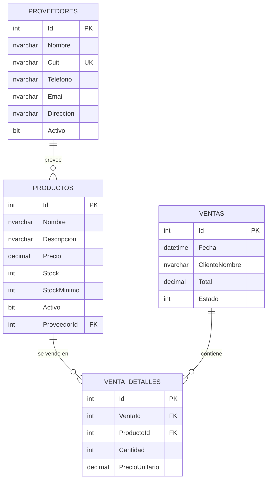

# Diagrama Entidad-Relación — Gestión Comercial

## Cardinalidades

| Relación | Tipo | Regla de negocio |
|---|---|---|
| Proveedor → Producto | 1 : N | Un proveedor puede tener muchos productos. No se permite borrar un proveedor con productos asociados (`DeleteBehavior.Restrict`). |
| Venta → VentaDetalle | 1 : N | Una venta tiene una o más líneas de detalle. Al borrar la venta se borran sus líneas en cascada (`DeleteBehavior.Cascade`). |
| Producto → VentaDetalle | 1 : N | Un producto puede aparecer en muchas líneas de venta. No se permite borrar un producto con ventas asociadas (`DeleteBehavior.Restrict`). |

## Cómo visualizar / exportar la imagen

1. Pegar el bloque `mermaid` de arriba en https://mermaid.live
2. Exportar como PNG/SVG desde ese sitio, o
3. En VS Code, instalar la extensión **"Markdown Preview Mermaid Support"** y previsualizar este archivo.
